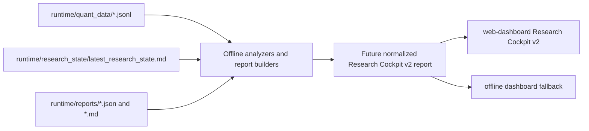

# Research Cockpit v2 Architecture Blueprint

```
scope: design only
source audit: research_cockpit_v2_gap_audit.md
runtime_behavior_changed: No
live_behavior_changed: No
implementation_status: blueprint only
```

Research Cockpit v2 is a future unified quant research dashboard for paper and offline evidence. It should make professional backtest-style performance, execution, fill, replay, lifecycle, inventory, and research evidence visible from one place without becoming a runtime decision engine.

The cockpit must read finalized report artifacts, not live trading internals. Missing evidence must display as missing, partial, stale, or unsupported; it must never be rendered as zero.

## Architecture



### Canonical Dashboard Shell

Future canonical shell: `web-dashboard`.

Legacy or fallback shells:

- `dashboard/offline_quant_report_dashboard.py` for local/offline inspection.
- Terminal Research Cockpit v1 for compact runtime observability, not professional backtest review.
- Markdown reports under `runtime/reports/` and copied research records under `docs/research/sessions/`.

### Data Flow

1. Runtime emits JSONL evidence under `runtime/quant_data/`.
2. Offline analyzers produce scoped JSON and Markdown reports under `runtime/reports/`.
3. A future normalizer creates one dashboard contract per run or session:

```text
runtime/reports/research_cockpit_v2_YYYY-MM-DD_run_RUN_ID.json
```

4. `web-dashboard` renders the normalized report with coverage badges, evidence links, and card-level status.
5. The dashboard does not call live APIs, submit orders, cancel orders, alter risk state, or feed automatic runtime policy.

### Status Semantics

Every card should carry a status:

| Status | Meaning |
|---|---|
| `AVAILABLE` | Direct field or validated offline derivation is present. |
| `PARTIAL` | Some producers or assets are covered, but not enough for a full claim. |
| `PROXY` | Derived from indirect evidence and not truth-confirming. |
| `MISSING` | Expected field is absent. |
| `UNSUPPORTED` | Current runtime/report system does not produce the evidence. |
| `STALE` | Source exists but is outside the selected run/session window. |
| `GAP` | Known evidence gap documented by audit or compact research state. |

### Source Tiers

| Tier | Use |
|---|---|
| Direct JSONL truth | Preferred source for event timestamps, identity, fills, lifecycle, inventory, and PnL. |
| Offline derived report | Preferred source for aggregate metrics and scoped diagnostics. |
| Proxy replay | Allowed only when labeled as `PROXY`; cannot be treated as continuity or fill truth. |
| Research memory / compact state | Used for research section, known gaps, and follow-up proposals. |
| Unsupported | Rendered as unavailable with required future fields. |

## Normalized Report Shape

The future report should be a stable read-only contract. Field names below are architecture targets, not implemented requirements.

```json
{
  "schema_version": "research_cockpit_v2",
  "run": {
    "run_id": "string",
    "date": "YYYY-MM-DD",
    "session_start_utc": "string",
    "session_end_utc": "string",
    "mode": "paper",
    "asset_filter": ["BTC", "ETH"],
    "source_freshness": "AVAILABLE"
  },
  "coverage": {
    "overall_status": "PARTIAL",
    "jsonl_sources_loaded": [],
    "reports_loaded": [],
    "missing_required_fields": [],
    "producer_coverage": {}
  },
  "sections": {
    "performance": {},
    "execution_reality": {},
    "fill_truth": {},
    "replay_truth": {},
    "lifecycle": {},
    "inventory": {},
    "outcome": {},
    "research": {}
  }
}
```

Each card should use this envelope:

```json
{
  "value": null,
  "unit": "string",
  "status": "MISSING",
  "source": "string",
  "jsonl_source": "string",
  "evidence_ref": "string",
  "notes": "string"
}
```

## Layout

Top bar:

- Run selector: date, run id, asset, mode, and report freshness.
- Coverage strip: JSONL producer coverage, report coverage, malformed-line status, and replay continuity status.
- Safety strip: paper/live status, offline-only flag, and "no runtime actions" marker.

Main page:

| Band | Sections | Layout |
|---|---|---|
| 1 | Performance, Execution Reality | Two-column desktop, stacked mobile. |
| 2 | Fill Truth, Replay Truth | Two-column diagnostic band with alert badges. |
| 3 | Lifecycle | Full-width phase timeline plus four phase cards. |
| 4 | Inventory, Outcome | Inventory state beside MFE/MAE and TP/SL outcome truth. |
| 5 | Research | Full-width frontier, unknown, contradiction, and Hermes proposal table. |

Card behavior:

- One primary value.
- One coverage badge.
- One source label.
- One drilldown link to the originating report or JSONL producer summary.
- No card should hide missingness behind default values.

Detail drawers:

- Evidence table with source file, event count, direct-field coverage, and derivation method.
- Asset split table for BTC vs ETH when available.
- Time-window chart for lifecycle, latency, MFE/MAE, and inventory pressure when available.

## 1. Performance

Cards:

- total trades
- win rate
- avg win
- avg loss
- pnl
- sharpe
- drawdown

### Layout

Performance should be the first dashboard band. It needs a compact card row for headline metrics and a secondary table for BTC vs ETH, TP vs SL, and realized vs unrealized PnL.

### Data Source

Existing likely sources:

- `tools/replay_analyzer.py` derived replay reports for total trades, win rate, gross PnL, average PnL, and asset split where present.
- `tools/paper_evaluation_report.py` and paper session summary outputs for session-level health and bottleneck context.
- `polymarket/backtester_5m.py` for Sharpe-style backtest metrics, but this is not yet unified with the web/offline report path.
- `runtime/reports/*.json` when available to `web-dashboard`.

### JSONL Source

Primary:

- `runtime/quant_data/trade_journal/*.jsonl`

Secondary:

- `runtime/quant_data/decision_log/*.jsonl`
- `runtime/quant_data/risk_log/*.jsonl`
- `runtime/quant_data/execution_log/*.jsonl`

### Future Fields

| Card | Future fields |
|---|---|
| total trades | `total_trades`, `trade_open_count`, `trade_close_count`, `paired_trade_count` |
| win rate | `wins`, `losses`, `breakeven_count`, `win_rate` |
| avg win | `avg_win`, `avg_win_net`, `avg_win_by_asset` |
| avg loss | `avg_loss`, `avg_loss_net`, `avg_loss_by_asset` |
| pnl | `gross_pnl`, `net_pnl`, `realized_pnl`, `unrealized_pnl`, `fees`, `pnl_by_asset` |
| sharpe | `sharpe`, `returns_series`, `returns_interval`, `sample_count` |
| drawdown | `max_drawdown`, `max_drawdown_pct`, `drawdown_series`, `drawdown_start_ts`, `drawdown_end_ts` |

### Dependencies

- Clean open/close pairing.
- Stable `paper_trade_replay_key` or equivalent join key.
- Consistent PnL sign convention.
- Explicit separation between backtest metrics and paper runtime metrics.
- Future normalized report must distinguish unavailable Sharpe from zero Sharpe.

## 2. Execution Reality

Cards:

- signal_to_submit_ms
- submit_to_ack_ms
- submit_to_fill_ms
- cancel_latency_ms
- quote_stale_ms

### Layout

Execution Reality should sit beside Performance. Cards should show median, p95, max, sample count, and coverage status. A detail drawer should show a timeline from signal creation to submit, ack, fill, cancel, and quote age.

### Data Source

Existing evidence is mostly indirect: decision latency, lifecycle timing, cycle latency, and execution events. The audit found no direct complete source for true execution timeline cards.

Future source should be an execution reality report derived from ordered event timestamps.

### JSONL Source

Primary:

- `runtime/quant_data/execution_log/*.jsonl`
- `runtime/quant_data/decision_log/*.jsonl`

Secondary:

- `runtime/quant_data/market_snapshots/*.jsonl`
- `runtime/quant_data/system_health/*.jsonl`

### Future Fields

| Card | Future fields |
|---|---|
| signal_to_submit_ms | `signal_ready_ts`, `order_submit_attempt_ts`, `signal_to_submit_ms` |
| submit_to_ack_ms | `order_submit_attempt_ts`, `order_ack_ts`, `submit_to_ack_ms`, `ack_status` |
| submit_to_fill_ms | `order_submit_attempt_ts`, `first_fill_ts`, `final_fill_ts`, `submit_to_first_fill_ms`, `submit_to_fill_ms` |
| cancel_latency_ms | `cancel_request_ts`, `cancel_ack_ts`, `cancel_latency_ms`, `cancel_status` |
| quote_stale_ms | `quote_snapshot_ts`, `order_submit_attempt_ts`, `quote_age_ms_at_submit`, `quote_stale_ms` |

### Dependencies

- Monotonic timestamp capture at each execution boundary.
- Shared order and candidate identity across decision and execution producers.
- Paper fill simulator must emit the same timeline envelope as any future live execution path, while clearly marking mode.
- Clock skew and missing timestamp checks in data quality reports.

## 3. Fill Truth

Cards:

- fill probability
- partial fill risk
- queue risk
- liquidity vanish
- adverse selection

### Layout

Fill Truth should be a diagnostic band, not a performance band. Cards should show probability/risk estimates with direct vs proxy labels. The detail view should include requested size, filled size, fill ratio, orderbook depth, and post-fill movement.

### Data Source

Current system can show some orderbook and simulated fill evidence, but professional fill truth is not yet available. Future reports should combine paper fill outcomes, orderbook snapshots, spread/depth context, and post-fill price movement.

### JSONL Source

Primary:

- `runtime/quant_data/execution_log/*.jsonl`
- `runtime/quant_data/trade_journal/*.jsonl`

Secondary:

- `runtime/quant_data/market_snapshots/*.jsonl`
- `runtime/quant_data/research_log/*.jsonl`

### Future Fields

| Card | Future fields |
|---|---|
| fill probability | `fill_probability`, `fill_probability_model`, `fill_attempt_count`, `filled_attempt_count` |
| partial fill risk | `requested_size`, `filled_size`, `fill_ratio`, `partial_fill`, `partial_fill_risk` |
| queue risk | `queue_depth_ahead`, `visible_depth_at_price`, `resting_order_seconds`, `queue_risk_score` |
| liquidity vanish | `liquidity_vanish_flag`, `depth_before_submit`, `depth_after_submit`, `spread_after_submit` |
| adverse selection | `post_fill_price_move`, `adverse_selection_bps`, `adverse_selection_flag`, `markout_window_ms` |

### Dependencies

- Orderbook snapshots tied to candidate and order identity.
- Fill simulator assumptions documented in the report.
- Distinction between simulated fill truth and live fill truth.
- Future queue and adverse selection metrics must remain research evidence until separately promoted.

## 4. Replay Truth

Cards:

- replay key coverage
- continuity
- open close match
- ghost fill alerts

### Layout

Replay Truth should show one coverage heatmap by producer and one alert table. The cards should answer whether the selected run can support conclusions before any performance or lifecycle interpretation is trusted.

### Data Source

Existing evidence:

- `tools/quant_data_quality.py`
- `tools/replay_analyzer.py`
- lifecycle truth reports and continuity reports in `runtime/reports/`
- compact state in `runtime/research_state/latest_research_state.md`

The current compact state says replay truth is partial and direct field coverage is low in older evidence, so v2 should make this unavoidable on-screen.

### JSONL Source

Primary:

- `runtime/quant_data/decision_log/*.jsonl`
- `runtime/quant_data/execution_log/*.jsonl`
- `runtime/quant_data/trade_journal/*.jsonl`
- `runtime/quant_data/risk_log/*.jsonl`
- `runtime/quant_data/market_snapshots/*.jsonl`

### Future Fields

| Card | Future fields |
|---|---|
| replay key coverage | `paper_trade_replay_key_coverage`, `coverage_by_producer`, `missing_key_count` |
| continuity | `candidate_trace_coverage`, `parent_trace_coverage`, `replay_chain_coverage`, `continuity_status` |
| open close match | `open_close_match_rate`, `matched_pair_count`, `unmatched_open_count`, `unmatched_close_count` |
| ghost fill alerts | `ghost_fill_count`, `ghost_fill_alerts`, `fill_without_open_count`, `close_without_inventory_count` |

### Dependencies

- Stable event identity: `run_id`, `candidate_trace_id`, `parent_candidate_trace_id`, `paper_trade_replay_key`, `replay_chain_id`.
- Producer-level coverage summaries.
- Strict refusal to upgrade proxy continuity to direct truth.
- Alert severity taxonomy for ghost fills, unmatched closes, and identity splits.

## 5. Lifecycle

Cards:

- OPENING
- ACTIVE
- PROFIT
- FINAL_DERISK

### Layout

Lifecycle should be a full-width timeline with four summary cards. The UI may use short labels, but the data model should preserve canonical terms:

| UI label | Canonical label |
|---|---|
| OPENING | `OPENING_SCAN` |
| ACTIVE | `ACTIVE_INVENTORY_TRADING` |
| PROFIT | `PROFIT_MANAGEMENT` |
| FINAL_DERISK | `FINAL_DERISK` |

Each phase card should show event count, duration, blocked count, successful transition count, and dominant reason.

### Data Source

Existing sources include decision lifecycle distributions, lifecycle truth reports, session runtime evaluator output, risk gate transition reports, and execution lifecycle fields where available.

### JSONL Source

Primary:

- `runtime/quant_data/decision_log/*.jsonl`
- `runtime/quant_data/execution_log/*.jsonl`
- `runtime/quant_data/risk_log/*.jsonl`

Secondary:

- `runtime/quant_data/market_snapshots/*.jsonl`
- `runtime/quant_data/research_log/*.jsonl`

### Future Fields

| Card | Future fields |
|---|---|
| OPENING | `opening_scan_event_count`, `opening_scan_duration_ms`, `opening_scan_block_count`, `opening_to_active_transition_count` |
| ACTIVE | `active_inventory_event_count`, `active_inventory_duration_ms`, `active_block_count`, `active_position_count` |
| PROFIT | `profit_management_event_count`, `profit_unload_attempts`, `profit_unload_successes`, `profit_transition_reason` |
| FINAL_DERISK | `final_derisk_event_count`, `forced_exit_count`, `derisk_success_count`, `derisk_failure_count` |

Shared fields:

- `lifecycle_phase`
- `lifecycle_enter_ts`
- `lifecycle_exit_ts`
- `phase_duration_ms`
- `transition_reason`
- `blocked_reason`
- `phase_status`

### Dependencies

- Lifecycle phase emitted consistently across producers.
- Phase transition identity tied to candidate and inventory context.
- Unknown lifecycle phase must remain visible rather than silently dropped.
- No lifecycle display should imply runtime inventory behavior exists unless code and tests later prove it.

## 6. Inventory

Cards:

- inventory pressure
- exposure
- survival
- stabilization

### Layout

Inventory should sit beside Outcome. It should show current and max observed exposure, pressure score, survival state, stabilization state, and risk budget context. A detail table should split by asset, market, lifecycle instance, and inventory context.

### Data Source

Current evidence is partial and mostly paper/offline. Future inventory cockpit data should come from offline inventory analytics and bounded replay reports, not from runtime policy changes.

### JSONL Source

Primary:

- `runtime/quant_data/trade_journal/*.jsonl`
- `runtime/quant_data/risk_log/*.jsonl`
- `runtime/quant_data/execution_log/*.jsonl`

Secondary:

- `runtime/quant_data/decision_log/*.jsonl`
- `runtime/quant_data/market_snapshots/*.jsonl`

### Future Fields

| Card | Future fields |
|---|---|
| inventory pressure | `inventory_pressure_score`, `inventory_pressure_reason`, `inventory_units`, `max_inventory_units` |
| exposure | `current_exposure`, `max_exposure`, `exposure_pct_bankroll`, `target_exposure`, `exposure_gap` |
| survival | `survival_status`, `survival_duration_ms`, `survival_drawdown`, `survival_exit_reason` |
| stabilization | `stabilization_status`, `stabilization_ts`, `stabilization_duration_ms`, `stabilization_reason` |

Shared Dynamic Quant Risk Budget context:

- `bankroll`
- `current_equity`
- `open_exposure`
- `realized_pnl`
- `unrealized_pnl`
- `market_risk_used`
- `session_risk_used`
- `drawdown`
- `tier_id`
- `risk_mode`
- `target_exposure`
- `current_exposure`

### Dependencies

- Position and inventory identity must be reliable before inventory cards can be direct truth.
- Exposure math must use one bankroll/equity convention.
- Risk mode and tier must be captured at the event timestamp.
- Inventory analytics remain paper/offline evidence until a separately scoped runtime phase.

## 7. Outcome

Cards:

- MFE
- MAE
- survived
- stabilized
- TP
- SL

### Layout

Outcome should show trade path quality after entry. Cards should include aggregate values and coverage status. A detail view should show per-trade path reconstruction, best favorable point, worst adverse point, close reason, TP/SL classification, and whether the position survived or stabilized.

### Data Source

Current audit findings: MFE/MAE fields exist in some producers but are not truthfully populated in the observed evidence. Future Outcome should depend on path-aware offline reports that connect trade open, market path, lifecycle events, and close.

### JSONL Source

Primary:

- `runtime/quant_data/trade_journal/*.jsonl`
- `runtime/quant_data/market_snapshots/*.jsonl`

Secondary:

- `runtime/quant_data/execution_log/*.jsonl`
- `runtime/quant_data/decision_log/*.jsonl`
- `runtime/quant_data/risk_log/*.jsonl`

### Future Fields

| Card | Future fields |
|---|---|
| MFE | `mfe_price`, `mfe_pnl`, `mfe_pct`, `time_to_mfe_ms`, `mfe_event_ts` |
| MAE | `mae_price`, `mae_pnl`, `mae_pct`, `time_to_mae_ms`, `mae_event_ts` |
| survived | `survived`, `survival_status`, `survival_duration_ms`, `survival_failure_reason` |
| stabilized | `stabilized`, `stabilization_status`, `stabilized_at_ts`, `stabilization_reason` |
| TP | `tp_hit`, `tp_price`, `tp_hit_ts`, `tp_exit_count`, `tp_missed_count` |
| SL | `sl_hit`, `sl_price`, `sl_hit_ts`, `sl_exit_count`, `sl_slippage_proxy` |

### Dependencies

- Path reconstruction must know entry price, side, size, timestamps, and close reason.
- Market snapshots must be joinable to the held position window.
- TP and SL must be separated from generic profit/loss close labels.
- MFE/MAE cards should remain `MISSING` or `GAP` until nonzero, path-derived evidence is available.

## 8. Research

Cards:

- frontiers
- unknowns
- contradictions
- Hermes proposals

### Layout

Research should be a full-width evidence management section. It should summarize what the cockpit can prove, what it cannot prove, where evidence conflicts, and what offline research proposals are ready for operator review.

### Data Source

Primary sources:

- `runtime/research_state/latest_research_state.md`
- `docs/research/sessions/**`
- `docs/research_memory/**`
- finalized Markdown reports under `runtime/reports/`
- future normalized v2 report summaries

### JSONL Source

Primary:

- `runtime/quant_data/research_log/*.jsonl`
- `runtime/quant_data/system_health/*.jsonl`

Context:

- Summaries from all other loaded producers.

### Future Fields

| Card | Future fields |
|---|---|
| frontiers | `frontier_id`, `frontier_title`, `frontier_status`, `required_evidence`, `owner_role` |
| unknowns | `unknown_id`, `unknown_statement`, `blocking_fields`, `evidence_needed`, `severity` |
| contradictions | `contradiction_id`, `source_a`, `source_b`, `conflict_summary`, `resolution_status` |
| Hermes proposals | `hermes_proposal_id`, `hypothesis`, `evidence_refs`, `risk_budget_impact`, `required_evidence`, `operator_decision`, `proposal_status` |

Hermes proposals are offline, operator-reviewed research proposals. They are not autonomous LLM calls in the realtime trading loop and must not trigger runtime actions.

### Dependencies

- Compact research state should remain the first-read summary for research tasks.
- Reports should tag claims as direct, partial, proxy, or unsupported.
- Contradictions must link to specific evidence files and fields.
- Proposal status must distinguish idea, evidence needed, rejected, approved for paper research, and implemented later by explicit scope.

## Cross-Section Dependencies

| Dependency | Needed by |
|---|---|
| Stable run identity | All sections |
| Stable candidate identity | Execution, Fill, Replay, Lifecycle, Outcome |
| Stable inventory identity | Inventory, Lifecycle, Outcome |
| Open/close pairing | Performance, Replay, Outcome |
| Market snapshot joinability | Execution, Fill, Outcome, Inventory |
| Direct timestamp fields | Execution, Lifecycle, Fill |
| Risk budget fields | Inventory, Lifecycle, Research |
| Report coverage summary | All sections |
| Schema validation | All sections |

## Future Report Dependencies

Existing tools that can feed v2:

- `tools/replay_analyzer.py`
- `tools/quant_data_quality.py`
- `tools/no_entry_analyzer.py`
- `tools/session_runtime_evaluator.py`
- `tools/paper_evaluation_report.py`
- existing Markdown reports in `runtime/reports/`
- compact state in `runtime/research_state/latest_research_state.md`

Future offline reports needed:

- `research_cockpit_v2_report` normalizer.
- execution reality timeline report.
- fill truth and markout report.
- replay key coverage report by producer.
- lifecycle phase transition report.
- inventory pressure and exposure report.
- MFE/MAE path report.
- research frontier and contradiction report.

These are future design dependencies only. This blueprint does not create them.

## Guardrails

- Dashboard is read-only.
- Dashboard consumes finalized files only.
- No direct wallet, exchange, CLOB, or live order APIs.
- No runtime policy feedback loop.
- No hidden conversion of missing fields to zero.
- No LLM or Hermes proposal generation inside the realtime trading loop.
- No claim that paper fill truth equals live fill truth.
- No claim that planned inventory analytics are implemented runtime inventory execution.

## Acceptance Criteria For Future v2

Research Cockpit v2 is architecturally ready when:

1. Every requested card maps to a normalized report field.
2. Every field has source, status, unit, and evidence reference.
3. Missing direct fields render as `MISSING`, `UNSUPPORTED`, or `GAP`.
4. BTC vs ETH, TP vs SL, and paper replay key coverage can be shown without custom one-off parsing.
5. Execution reality latencies are direct timestamp derivations, not inferred placeholders.
6. MFE/MAE are path-derived from held-position windows.
7. Inventory and lifecycle cards remain clearly paper/offline until runtime inventory work is separately scoped.
8. Research proposals are operator-reviewed offline artifacts, not runtime actions.

