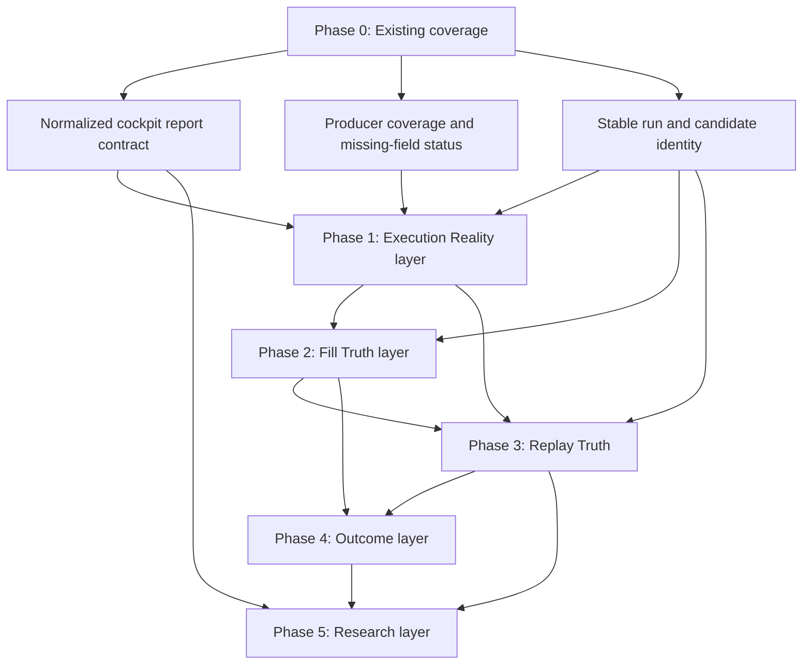

# Research Cockpit v2 Roadmap + Dependency Graph

```
scope: design only
inputs:
  - docs/research/performance/research_cockpit_v2_architecture.md
  - research_cockpit_v2_gap_audit.md
runtime_behavior_changed: No
live_behavior_changed: No
implementation_status: roadmap only
```

This roadmap defines the build order for Research Cockpit v2. It does not implement dashboard code, runtime logging, strategy behavior, execution behavior, risk rules, wallet behavior, or live trading support.

The key ordering rule is: existing offline evidence first, execution timestamps second, fill truth third, replay integrity fourth, outcome path truth fifth, and research synthesis last.

## Dependency Graph



## Build Order Summary

| Phase | Layer | Build order reason | Current action type |
|---|---|---|---|
| Phase 0 | Existing coverage | Harvests lifecycle, replay, risk, reports, and paper evidence already present. | Audit-only/offline report normalization. |
| Phase 1 | Execution Reality | Required before professional fill or latency claims. | Future runtime observability plus offline reports. |
| Phase 2 | Fill Truth | Depends on execution timing and quote/depth context. | Future runtime observability plus offline fill reports. |
| Phase 3 | Replay Truth | Formalizes identity, continuity, open/close matching, and ghost-fill detection. | Hybrid: runtime identity fields plus offline validation. |
| Phase 4 | Outcome | MFE/MAE/survival/stabilization require replay-safe held-position windows. | Future runtime/path fields plus offline replay. |
| Phase 5 | Research | Frontiers, unknowns, contradictions, and Hermes proposals depend on prior evidence quality. | Offline/audit-only synthesis. |

## Cross-Phase Gates

| Gate | Required before |
|---|---|
| `run_id` coverage | Any v2 report should be generated. |
| `paper_trade_replay_key` or equivalent stable join key | Replay, performance splits, fill truth, and outcome truth. |
| Missing-field status envelope | Any dashboard card is rendered. |
| Direct timestamp pairs | Execution Reality and Fill Truth. |
| Open/close pairing | Replay Truth and Outcome. |
| Market snapshot joinability | Fill Truth and Outcome. |
| MFE/MAE path evidence | Outcome and Research claims about trade quality. |

## Phase 0 - Existing Coverage

Already available:

- lifecycle
- replay
- risk
- reports
- paper evidence

### Status

Partially available. Existing terminal displays, offline tools, compact research state, and Markdown reports already cover lifecycle distribution, replay health, risk bottlenecks, report inventory, and paper-session evidence. The gap is not absence of all evidence; the gap is that evidence is scattered and not normalized into the v2 dashboard contract.

### Blockers

- `web-dashboard` currently expects JSON reports, while the currently observed `runtime/reports/` inventory is Markdown-only.
- Performance, replay, risk, and paper evidence exist across multiple tools and reports rather than one stable schema.
- Missing fields can be mistaken for zeros unless card-level status is enforced.
- Some older replay evidence has low direct-field coverage and proxy-heavy identity.

### Required Fields

- `run_id`
- `date`
- `session_start_utc`
- `session_end_utc`
- `mode`
- `paper_live_status`
- `source_reports_loaded`
- `jsonl_sources_loaded`
- `producer_coverage`
- `missing_required_fields`
- `card_status`
- `evidence_ref`

### JSONL Dependencies

Primary:

- `runtime/quant_data/decision_log/*.jsonl`
- `runtime/quant_data/execution_log/*.jsonl`
- `runtime/quant_data/risk_log/*.jsonl`
- `runtime/quant_data/trade_journal/*.jsonl`
- `runtime/quant_data/market_snapshots/*.jsonl`

Supporting:

- `runtime/quant_data/research_log/*.jsonl`
- `runtime/quant_data/system_health/*.jsonl`

### Implementation Difficulty

Low to medium. Most Phase 0 work is report normalization and dashboard schema mapping from existing evidence.

### Runtime Impact

None required. Phase 0 should be offline-only and should not alter runtime behavior.

### Audit-Only Or Runtime

Audit-only/offline. The future build should consume existing reports and JSONL output, then mark gaps explicitly.

## Phase 1 - Execution Reality Layer

Dependencies:

- `signal_to_submit_ms`
- `submit_to_fill_ms`
- `cancel_latency`
- `quote_stale`

### Status

Weak. Existing systems show decision latency and lifecycle timing, but not true execution reality. The audit found no reliable direct fields for `signal_to_submit_ms`, `submit_to_fill_ms`, `quote_stale_ms`, or `cancel_latency_ms`.

### Blockers

- Missing direct timestamp pairs for signal, submit, ack, fill, cancel, and quote age.
- Paper fills are synthetic and may not currently preserve the same event envelope needed for future live comparison.
- Submit, fill, and cancel events need stable candidate/order identity.
- Current decision latency must not be misrepresented as execution latency.

### Required Fields

- `signal_ready_ts`
- `order_submit_attempt_ts`
- `order_ack_ts`
- `first_fill_ts`
- `final_fill_ts`
- `cancel_request_ts`
- `cancel_ack_ts`
- `quote_snapshot_ts`
- `signal_to_submit_ms`
- `submit_to_ack_ms`
- `submit_to_first_fill_ms`
- `submit_to_fill_ms`
- `cancel_latency_ms`
- `quote_age_ms_at_submit`
- `quote_stale_ms`
- `order_id`
- `candidate_trace_id`
- `paper_trade_replay_key`

### JSONL Dependencies

Primary:

- `runtime/quant_data/execution_log/*.jsonl`
- `runtime/quant_data/decision_log/*.jsonl`

Supporting:

- `runtime/quant_data/market_snapshots/*.jsonl`
- `runtime/quant_data/system_health/*.jsonl`

### Implementation Difficulty

Medium to high. The dashboard/report layer is straightforward once fields exist, but the timestamp envelope needs careful observability-only runtime instrumentation and tests to avoid inventing latency from incomplete data.

### Runtime Impact

Future runtime observability impact is required. It should be field emission only: no order policy changes, no fill behavior changes, no risk changes, and no live-readiness claim.

### Audit-Only Or Runtime

Future layer requires runtime observability fields plus offline aggregation. This roadmap document itself is audit-only.

## Phase 2 - Fill Truth Layer

Dependencies:

- partial fill
- queue risk
- depth coverage
- liquidity vanish

### Status

Partial. Paper fill events and partial flags exist in some evidence, but fill probability, fill ratio, residual size, queue risk, liquidity vanish, and adverse selection are not normalized into a professional fill-truth layer.

### Blockers

- Fill probability cannot be trusted without submit/fill timing from Phase 1.
- Queue risk needs depth at price, visible depth ahead, and resting duration.
- Liquidity vanish needs before/after depth snapshots tied to submit time.
- Adverse selection needs post-fill markout windows and market snapshot joinability.
- Paper fill truth and live fill truth must remain separate.

### Required Fields

- `requested_size`
- `filled_size`
- `residual_size`
- `fill_ratio`
- `partial_fill`
- `partial_fill_risk`
- `fill_probability`
- `fill_attempt_count`
- `filled_attempt_count`
- `visible_depth_at_price`
- `queue_depth_ahead`
- `resting_order_seconds`
- `depth_before_submit`
- `depth_after_submit`
- `liquidity_vanish_flag`
- `spread_before_submit`
- `spread_after_submit`
- `post_fill_price_move`
- `adverse_selection_bps`
- `markout_window_ms`

### JSONL Dependencies

Primary:

- `runtime/quant_data/execution_log/*.jsonl`
- `runtime/quant_data/trade_journal/*.jsonl`
- `runtime/quant_data/market_snapshots/*.jsonl`

Supporting:

- `runtime/quant_data/decision_log/*.jsonl`
- `runtime/quant_data/research_log/*.jsonl`

### Implementation Difficulty

High. Fill truth depends on both event timing and market microstructure evidence. The hard part is not displaying the cards; the hard part is preventing proxy or simulated assumptions from being mistaken for direct truth.

### Runtime Impact

Future runtime observability impact is likely required for compact depth, quote, and fill envelope fields. It should not alter order placement, cancel behavior, risk approval, or paper/live separation.

### Audit-Only Or Runtime

Future layer is hybrid: runtime observability fields plus offline fill-truth reporting. This roadmap document is audit-only.

## Phase 3 - Replay Truth

Dependencies:

- `paper_trade_replay_key`
- open close continuity
- ghost fill detection

### Status

Partial to strong in concept, partial in current availability. Replay analyzers, data quality tools, continuity reports, and compact state exist. The gap is producer-level coverage and unified v2 visibility. Older compact state also shows direct identity and continuity weaknesses, especially across decision, risk, execution, and trade journal boundaries.

### Blockers

- `paper_trade_replay_key` coverage is not yet surfaced by producer in the web dashboard.
- Open/close matching must be explicit and scoped by run.
- Ghost fill detection requires reliable inventory, fill, and close identity.
- Candidate trace identity and parent trace identity remain uneven across producers.
- Proxy continuity must not be upgraded into direct truth.

### Required Fields

- `paper_trade_replay_key`
- `paper_trade_replay_key_coverage`
- `coverage_by_producer`
- `candidate_trace_id`
- `parent_candidate_trace_id`
- `replay_chain_id`
- `trace_link_reason`
- `market_key`
- `condition_id`
- `token_id`
- `side`
- `open_close_match_rate`
- `matched_pair_count`
- `unmatched_open_count`
- `unmatched_close_count`
- `ghost_fill_count`
- `fill_without_open_count`
- `close_without_inventory_count`
- `continuity_status`

### JSONL Dependencies

Primary:

- `runtime/quant_data/decision_log/*.jsonl`
- `runtime/quant_data/risk_log/*.jsonl`
- `runtime/quant_data/execution_log/*.jsonl`
- `runtime/quant_data/trade_journal/*.jsonl`
- `runtime/quant_data/market_snapshots/*.jsonl`

Supporting:

- `runtime/quant_data/system_health/*.jsonl`
- `runtime/quant_data/research_log/*.jsonl`

### Implementation Difficulty

Medium to high. Existing replay tooling helps, but producer-level identity coverage and ghost-fill detection require careful schema discipline and regression tests.

### Runtime Impact

Mostly offline, but future runtime identity fields may be needed where producers do not emit stable keys. Runtime impact should remain observability-only.

### Audit-Only Or Runtime

Hybrid. The validation and display layer are audit/offline; complete truth may require runtime identity emission.

## Phase 4 - Outcome Layer

Dependencies:

- canonical MFE
- canonical MAE
- survived
- stabilized

### Status

Weak to partial. Survived and stabilized exist in terminal/offline research tools, but web v2 does not ingest them. MFE/MAE fields exist in some evidence, but current audit findings show zero/null peak tracking and no reliable path-derived truth.

### Blockers

- Canonical MFE and MAE need held-position path reconstruction, not static open-time fields.
- Market snapshots must join cleanly to open/close windows.
- Open/close continuity from Phase 3 is required before outcome truth can be trusted.
- TP and SL classification must be separated from generic close reason strings.
- Survival and stabilization need canonical definitions that do not imply runtime inventory execution.

### Required Fields

- `entry_ts`
- `entry_price`
- `entry_side`
- `entry_size`
- `close_ts`
- `close_price`
- `close_reason`
- `held_window_start_ts`
- `held_window_end_ts`
- `mfe_price`
- `mfe_pnl`
- `mfe_pct`
- `mfe_event_ts`
- `time_to_mfe_ms`
- `mae_price`
- `mae_pnl`
- `mae_pct`
- `mae_event_ts`
- `time_to_mae_ms`
- `survived`
- `survival_status`
- `survival_duration_ms`
- `stabilized`
- `stabilization_status`
- `stabilized_at_ts`
- `tp_hit`
- `sl_hit`

### JSONL Dependencies

Primary:

- `runtime/quant_data/trade_journal/*.jsonl`
- `runtime/quant_data/market_snapshots/*.jsonl`
- `runtime/quant_data/execution_log/*.jsonl`

Supporting:

- `runtime/quant_data/decision_log/*.jsonl`
- `runtime/quant_data/risk_log/*.jsonl`
- `runtime/quant_data/research_log/*.jsonl`

### Implementation Difficulty

High. Outcome truth depends on reliable replay identity, market-path joinability, and canonical MFE/MAE semantics. Display is simple only after the evidence contract is clean.

### Runtime Impact

Future runtime impact may be needed for canonical path fields or held-position state emission, but the preferred computation should remain offline replay wherever possible. No runtime policy change is implied.

### Audit-Only Or Runtime

Hybrid. Outcome reports are offline, but canonical MFE/MAE may require better runtime evidence emission.

## Phase 5 - Research Layer

Dependencies:

- Hermes proposals
- contradictions
- frontiers
- unknowns

### Status

Partial. Compact research state, research memory, Markdown reports, and audit documents already describe frontiers and blind spots. The missing layer is a structured cockpit view that turns those notes into status cards, contradictions, and operator-reviewed proposals.

### Blockers

- Research cards depend on prior phases carrying direct, partial, proxy, missing, and unsupported status correctly.
- Hermes proposals must remain offline and operator-reviewed.
- Contradictions need source references, not free-form claims.
- Unknowns must link to missing fields and blocking dependencies.
- Research output must not become an automatic runtime policy loop.

### Required Fields

- `frontier_id`
- `frontier_title`
- `frontier_status`
- `unknown_id`
- `unknown_statement`
- `blocking_fields`
- `contradiction_id`
- `source_a`
- `source_b`
- `conflict_summary`
- `resolution_status`
- `hermes_proposal_id`
- `hypothesis`
- `evidence_refs`
- `risk_budget_impact`
- `required_evidence`
- `operator_decision`
- `proposal_status`

### JSONL Dependencies

Primary:

- `runtime/quant_data/research_log/*.jsonl`
- `runtime/quant_data/system_health/*.jsonl`

Supporting:

- Summaries from all prior phase reports.
- `runtime/research_state/latest_research_state.md`
- `docs/research/sessions/**`
- `docs/research_memory/**`

### Implementation Difficulty

Medium. The technical display is moderate; the harder part is maintaining disciplined claim status and avoiding vague proposals without evidence links.

### Runtime Impact

None required. Hermes proposals, contradictions, frontiers, and unknowns should be offline research artifacts only.

### Audit-Only Or Runtime

Audit-only/offline.

## Critical Path

1. Normalize existing coverage into a v2 report contract.
2. Add or derive direct execution timestamp fields.
3. Build fill-truth evidence from execution timing and orderbook depth context.
4. Formalize replay-key coverage, open/close continuity, and ghost-fill alerts.
5. Build canonical MFE/MAE, survived, stabilized, TP, and SL outcome reports.
6. Surface frontiers, unknowns, contradictions, and Hermes proposals as offline research controls.

## Phase Promotion Gates

| From | To | Gate |
|---|---|---|
| Phase 0 | Phase 1 | v2 report contract marks missing fields without zeros and can load existing evidence. |
| Phase 1 | Phase 2 | Direct timestamp coverage exists for submit/fill/cancel/quote age or cards remain explicitly unavailable. |
| Phase 2 | Phase 3 | Fill events carry enough identity to match candidate, order, quote, depth, and journal records. |
| Phase 3 | Phase 4 | Open/close continuity and ghost-fill checks pass for the selected run. |
| Phase 4 | Phase 5 | MFE/MAE and survival/stabilization carry direct or clearly labeled offline-derived evidence. |

## Safety Boundaries

- This roadmap is design-only.
- No implementation was performed.
- Runtime fields listed here are future observability requirements, not proof they exist.
- Offline analyzers and dashboard reports remain evidence-only.
- No strategy, risk, execution, wallet, allowance, order intent, reconciliation, or live-mode behavior is changed or authorized.
- Missing metrics must render as missing, unsupported, or gap status, never as zero.

