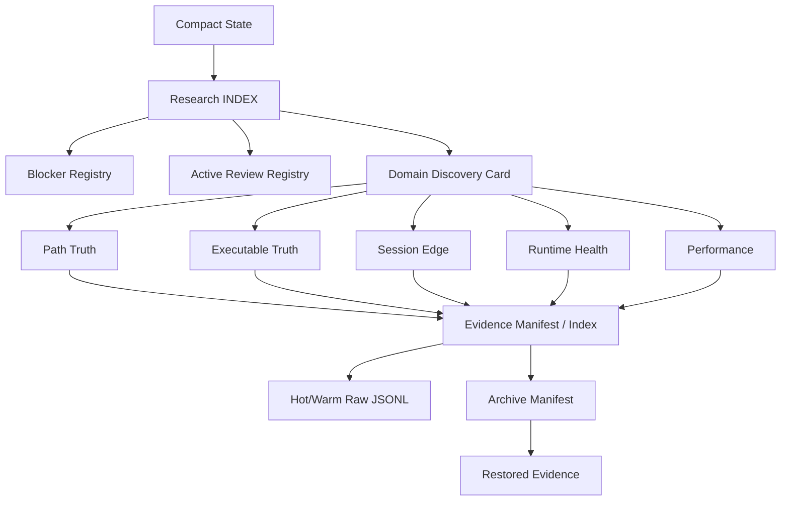

# Research Evidence Discovery Layer Design

Date: 2026-05-28

Repo: `C:\quant\Polymarket-Adaptive-Quant-Engine-v.1`

Mode: docs-only design. No implementation, no runtime mutation, no indexing execution, no library installs, no replay, no strategy/risk/execution/live changes.

## Executive Verdict

The research platform needs a discovery layer that sits between human governance docs and raw runtime evidence:

```text
compact state
-> research index
-> domain discovery cards
-> manifest/index pointers
-> archive manifests if cold
-> targeted raw evidence only when needed
```

This layer should let agents and operators answer:

- What is active right now?
- What blockers matter most?
- Which domain owns this question?
- What evidence supports or blocks the claim?
- Where is the raw evidence, and is it hot, warm, or archived?
- What is the lineage confidence?

The discovery layer is cognition/navigation only. It must not become a runtime policy surface, strategy input, risk override, replay engine, or executable PnL authority.

## Design Goals

| Goal | Meaning |
|---|---|
| Avoid whole-repo scans | Agents start from compact indexes and domain cards, not raw folders. |
| Surface current blockers fast | Operators can see active blockers and top unlock chain quickly. |
| Preserve domain ownership | Path Truth, Executable Truth, Session Edge, Runtime Health, and Performance remain separated. |
| Traverse lineage safely | Claims link to source docs, manifests, run IDs, replay keys, and archive refs. |
| Keep contradiction reviews visible | Weakened/adverse/unavailable splits stay hot until resolved. |
| Bridge cognition and evidence | Docs point to manifests; manifests point to raw evidence. |
| Preserve archive awareness | Cold evidence remains discoverable without being hot. |

## Non-Goals

- No implementation.
- No generated index files.
- No raw evidence scan.
- No runtime mutation.
- No replay run.
- No archive move.
- No library install.
- No strategy/risk/execution/live change.
- No executable PnL claim.

## 1. Research Discovery Topology

Target topology:

```text
runtime/research_state/latest_research_state.md
  |
  v
docs/research/INDEX.md
  |
  +-- domain discovery cards
  |     +-- path_truth/
  |     +-- executable_truth/
  |     +-- session_edge/
  |     +-- runtime_health/
  |     +-- performance/
  |
  +-- active review registry
  +-- blocker registry
  +-- contradiction registry
  +-- lineage registry
  |
  v
future evidence manifests/indexes
  |
  v
hot/warm raw JSONL or archive manifests
```

The current `docs/research/INDEX.md` remains the human entry point. Future discovery metadata should not replace it; it should make the index queryable and less dependent on manually reading many files.

### Discovery Layers

| Layer | Artifact | Purpose | Runtime authority |
|---|---|---|---|
| Compact state | `runtime/research_state/latest_research_state.md` | Fast startup state and top blind spots. | None |
| Root cognition | `docs/research/INDEX.md` | Current phase, blockers, active reviews, domain routing. | None |
| Domain discovery | future domain cards/registries | Domain-specific active docs and evidence pointers. | None |
| Evidence manifests | future manifest/index layer | Date/run/source/lineage location. | None |
| Archive manifests | future archive manifest layer | Cold evidence custody and restore path. | None |
| Raw evidence | JSONL/logs | Canonical source truth. | Runtime emits only |

## 2. Domain Discovery Rules

Every discovery query should choose one primary domain before touching evidence.

| Question type | Primary domain | First doc/index |
|---|---|---|
| path continuity, replay key, checkpoints | Path Truth | `docs/research/path_truth/path_truth_multiday_coverage_monitor.md` |
| executable PnL, MOS, dust, fill/cancel truth | Executable Truth | `docs/research/executable_truth/executable_truth_frontier_map.md` |
| session/hour/asset/side/lifecycle edge | Session Edge | `docs/research/session_edge/session_edge_missing_split_refresh.md` or current review doc |
| no-trade, rejections, runtime exceptions, process health | Runtime Health | `docs/research/runtime_health/runtime_evidence_farming_audit.md` or current audit |
| UI, dashboard, performance stack, archive/index design | Performance | `docs/research/performance/quant_performance_stack_roadmap.md` |
| date-specific paper evidence package | Sessions | `docs/research/sessions/YYYY-MM-DD/` |
| migration/governance/archive rules | Root Governance | `docs/research/INDEX.md` and cleanup/action-plan docs |

Domain rule:

```text
One primary domain, optional cross-domain traversal, no raw scan until domain and lineage path are known.
```

## 3. Cross-Domain Lineage Traversal

Cross-domain traversal should be explicit and acyclic where possible.

Recommended traversal graph:



Traversal rules:

1. Start from the smallest current-state artifact.
2. Select a primary domain.
3. Identify the active doc or blocker record.
4. Follow explicit source refs to manifest/index rows.
5. Use raw JSONL only for targeted verification.
6. If evidence is cold, use archive manifest before restore.
7. Record whether the evidence is raw, derived, proxy, or cognition-only.

Cross-domain examples:

| Starting question | Primary domain | Cross-domain path |
|---|---|---|
| Is executable PnL unblocked? | Executable Truth | Executable -> Path Truth direct join -> Execution/Fill Truth -> MOS docs |
| Is 02h hostile still valid? | Session Edge | Session Edge -> Path Truth coverage -> Runtime Health exceptions -> manifest rows |
| Why did no trades open? | Runtime Health | Runtime Health -> decision logs -> Session Edge context -> executable dust/MOS blockers |
| Can a date be archived? | Performance | Archive boundary -> active reviews -> domain locks -> file manifest |

## 4. Active Review Discovery

Active reviews are open questions that must remain visible until resolved, weakened, invalidated, or archived.

Recommended future logical registry:

```text
active_review_registry
```

Fields:

| Field | Class | Meaning |
|---|---|---|
| `review_id` | governance metadata | Stable review ID. |
| `title` | cognition metadata | Human-readable label. |
| `domain` | governance metadata | Primary owner domain. |
| `status` | cognition metadata | `ACTIVE`, `KEEP_HOT`, `REVIEW_ONLY`, `RESOLVED`, `ARCHIVE_READY`. |
| `opened_at` | governance metadata | Date review began. |
| `last_updated` | cognition metadata | Last doc/index update. |
| `primary_doc` | cognition metadata | Canonical doc path. |
| `supporting_docs` | cognition metadata | Supporting docs. |
| `evidence_scope` | replay metadata | Date/run/source/trade scope. |
| `manifest_refs` | archive discovery metadata | Future manifest/index pointers. |
| `archive_lock` | archive discovery metadata | Whether evidence must stay hot/warm. |
| `next_action` | cognition metadata | Recommended follow-up. |
| `policy_authority` | governance metadata | Normally `NONE`. |

Current examples that discovery should surface:

- evidence farming;
- Path Truth gate;
- replay-key validation lineage;
- executable truth blockers;
- session-edge contradiction review;
- runtime no-trade/rejection review;
- delta extreme review;
- empty book ambiguity.

## 5. Blocker Discovery

Blockers are stronger than active reviews: they prevent truth promotion, Growth readiness, executable PnL, or archive movement.

Recommended future logical registry:

```text
blocker_registry
```

Fields:

| Field | Class | Meaning |
|---|---|---|
| `blocker_id` | governance metadata | Stable blocker key. |
| `domain` | governance metadata | Primary owner domain. |
| `status` | cognition metadata | `BLOCKED`, `REVIEW_ONLY`, `PARTIAL`, `RESOLVED_LINEAGE`, etc. |
| `severity` | cognition metadata | `HIGH`, `MEDIUM`, `LOW`, `INFO`. |
| `truth_layer_blocked` | cognition metadata | Signal/Path/Executable/Growth/Live. |
| `source_doc` | cognition metadata | Canonical explanation. |
| `required_unlock` | cognition metadata | What must change before promotion. |
| `evidence_scope` | replay metadata | Date/run/source/trade scope. |
| `lineage_confidence` | replay metadata | Direct/strong/weak/proxy/blocked. |
| `archive_lock` | archive discovery metadata | Whether evidence must stay hot/warm. |
| `operator_note` | cognition metadata | Caveat/summary. |

Current blocker classes:

| Blocker | Domain | Discovery behavior |
|---|---|---|
| `RUNTIME_TRUTH_UNKNOWN` | Runtime Health / Executable Truth | Keep hot until canonical runtime truth fields exist. |
| `MOS_UNKNOWN` | Executable Truth | Link MOS/dust docs and executable frontier. |
| `EXECUTABLE_PNL_BLOCKED` | Executable Truth | Never surface as ready until fill/cancel/partial-fill/MOS truth exists. |
| `empty_book ambiguity` | Runtime Health | Link no-trade/rejection/delta docs and health evidence. |

Resolved lineage such as `PATH_JOIN_0_77` should remain discoverable but not appear as active blocker for post-wiring rows.

## 6. Session-Edge Discovery

Session-edge discovery should support research review without becoming a policy input.

Recommended future logical registry:

```text
session_edge_registry
```

Fields:

| Field | Class | Meaning |
|---|---|---|
| `candidate_id` | cognition metadata | Research candidate label. |
| `session_hour_utc` | replay metadata | Hour/session bucket. |
| `asset_scope` | replay metadata | BTC/ETH/all. |
| `side_scope` | replay metadata | YES/NO/all. |
| `lifecycle_scope` | replay metadata | OPENING/ACTIVE/all. |
| `price_bucket_scope` | replay metadata | Price bucket if available. |
| `regime_scope` | replay metadata | Regime if available. |
| `sample_size` | replay metadata | Trade count. |
| `date_coverage` | replay metadata | Completed dates represented. |
| `tp_sl_summary` | replay metadata | TP/SL distribution. |
| `fast_close_summary` | replay metadata | Fast-close distribution. |
| `path_truth_join_rate` | replay metadata | Join confidence. |
| `current_verdict` | cognition metadata | `SUPPORTED`, `WEAKENED`, `ADVERSE`, `UNAVAILABLE`, `INSUFFICIENT`. |
| `contradiction_status` | cognition metadata | `NONE`, `ACTIVE`, `RESOLVED`, `NEEDS_CONTROL`. |
| `primary_doc` | cognition metadata | Canonical review doc. |
| `policy_authority` | governance metadata | Always `NONE` unless explicit future implementation. |

Current discovery priorities:

- 02h hostile candidate;
- 09h10h edge degradation/partial survival;
- BTC hostile candidate;
- NO session-dependent weakness;
- fast-close real behavior;
- outside-session controls;
- missing split refreshes.

Session-edge discovery must always display sample size and date coverage before any verdict.

## 7. Executable-Truth Discovery

Executable truth discovery must protect against accidental profitability claims.

Recommended future logical registry:

```text
executable_truth_registry
```

Fields:

| Field | Class | Meaning |
|---|---|---|
| `truth_item_id` | cognition metadata | Blocker/unlock item. |
| `truth_layer` | cognition metadata | Signal, Path, Executable, Growth. |
| `status` | cognition metadata | `BLOCKED`, `PARTIAL`, `UNLOCK_EVIDENCE`, `EXECUTABLE_EVIDENCE`. |
| `mos_status` | cognition metadata | Unknown/assumed/confirmed. |
| `dust_status` | cognition metadata | Dust evidence state. |
| `fill_truth_status` | cognition metadata | Missing/partial/available. |
| `cancel_truth_status` | cognition metadata | Missing/partial/available. |
| `partial_fill_truth_status` | cognition metadata | Missing/partial/available. |
| `path_join_status` | replay metadata | Direct/proxy/blocked. |
| `signal_pnl_status` | cognition metadata | Available/partial/blocked. |
| `executable_pnl_status` | cognition metadata | Normally `BLOCKED` until full unlock. |
| `hermes_ingest_class` | cognition metadata | Signal/blocker/dust/unlock/executable evidence. |
| `source_docs` | cognition metadata | Frontier, ledger, source audit docs. |
| `manifest_refs` | archive discovery metadata | Future evidence index rows. |

Executable discovery rules:

- `signal_pnl` can be discoverable.
- `dust_zone` can be discoverable as blocker evidence.
- `executable_minimum_met` can be discoverable as derived assumption evidence.
- `executable_candidate` can be discoverable as partial/unlock evidence.
- `executable_pnl` remains `N_A / BLOCKED` until required truth fields exist.

No discovery surface should present executable PnL as available unless the registry explicitly shows all unlocks satisfied.

## 8. Path-Truth Lineage Traversal

Path Truth is the central continuity bridge.

Traversal spine:

```text
date
-> run_id
-> paper_trade_replay_key
-> trade_open / trade_close
-> path checkpoints
-> execution / decision context
-> research verdict
```

Recommended future logical registry:

```text
path_truth_lineage_registry
```

Fields:

| Field | Class | Meaning |
|---|---|---|
| `run_id` | replay metadata | Run identity. |
| `paper_trade_replay_key` | replay metadata | Direct join key. |
| `trade_id` | replay metadata | Trade ID if available. |
| `asset` | replay metadata | BTC/ETH. |
| `side` | replay metadata | YES/NO. |
| `lifecycle_phase` | replay metadata | OPENING/ACTIVE/etc. |
| `trade_open_ref` | replay metadata | Source pointer. |
| `trade_close_ref` | replay metadata | Source pointer. |
| `path_checkpoint_refs` | replay metadata | Source pointers. |
| `has_15s` | replay metadata | Checkpoint coverage. |
| `has_30s` | replay metadata | Checkpoint coverage. |
| `has_45s` | replay metadata | Checkpoint coverage. |
| `has_60s` | replay metadata | Checkpoint coverage. |
| `has_event_end` | replay metadata | Terminal checkpoint. |
| `full_coverage` | replay metadata | Complete path. |
| `fast_close` | replay metadata | Fast close classification. |
| `join_confidence` | replay metadata | Direct/strong/weak/proxy/blocked. |
| `legacy_null_row` | archive discovery metadata | Historical missing-key caveat. |
| `source_manifest_ref` | archive discovery metadata | Manifest row. |

Path traversal rules:

- Prefer `(run_id, paper_trade_replay_key)`.
- Never silently repair legacy null rows.
- Do not treat Path Truth as fill truth.
- Do not treat direct path join as executable PnL readiness.
- Always carry join confidence into downstream discovery.

## 9. Archive-Aware Discovery

Archive-aware discovery prevents old evidence from disappearing when it moves cold.

Discovery flow:

```text
domain doc
-> manifest/index ref
-> archive class
-> archive MANIFEST.md if cold
-> restore/rehydration plan if raw rows are needed
```

Archive discovery metadata:

| Field | Meaning |
|---|---|
| `archive_class` | Hot/warm/cold/restored readiness. |
| `source_manifest_ref` | File/run/schema manifest row. |
| `archive_manifest_ref` | Cold evidence custody manifest. |
| `restore_required` | Whether raw row access needs rehydration. |
| `restore_path` | Temporary restored path, if exists. |
| `source_sha256` | Integrity check. |
| `line_count` | Source row count. |
| `parse_error_count` | Quality caveat. |
| `research_lock` | Whether evidence must remain hot/warm. |

Archive-aware rules:

- Cold evidence remains discoverable through manifests.
- Restored evidence must not be mixed into active runtime paths.
- Archive status does not change truth status.
- Operators should see when evidence is cold before requesting raw verification.

## 10. Future Agent Retrieval Flow

Default agent retrieval flow:

```text
1. Read compact state.
2. Read research INDEX.
3. Identify primary domain.
4. Read the active domain doc or registry card.
5. Check blocker/review status.
6. Follow manifest/index references.
7. If evidence is cold, inspect archive manifest.
8. Open raw JSONL only for targeted verification.
9. Report evidence class, lineage confidence, and truth ceiling.
```

Task-specific shortcuts:

| Task | Retrieval path |
|---|---|
| Morning runtime audit | compact state -> INDEX -> runtime health active docs -> run/daily manifests -> latest logs only if needed |
| Path Truth gate review | INDEX -> path truth monitor -> path lineage registry -> path truth index -> raw rows if targeted |
| Session-edge review | INDEX -> session-edge registry -> session edge index -> path join confidence -> source docs |
| Executable truth audit | INDEX -> executable frontier -> executable registry -> run/path/decision/execution manifests |
| Archive review | INDEX -> archive boundary design -> daily/file manifests -> active research locks -> archive manifest |
| UI/performance work | INDEX -> performance docs -> discovery/manifest docs -> no raw evidence unless explicitly scoped |

Agents should include in final reports:

- primary domain;
- source docs inspected;
- evidence level used: cognition, manifest, derived index, raw JSONL, archive manifest, restored evidence;
- lineage confidence;
- truth ceiling;
- runtime behavior changed: No, unless explicitly implemented in a future task.

## Metadata Classification

### Hot Discovery Metadata

Kept instantly available:

- current project phase;
- active blockers;
- active reviews;
- current top unlock chain;
- latest run ID if compact state has it;
- latest gate states;
- current domain index links;
- latest replay-key/path-truth validation caveats;
- archive class of latest evidence.

### Archive Discovery Metadata

Used to find cold evidence:

- archive class;
- source path;
- archive path;
- archive manifest ref;
- source hash;
- line count;
- parse error count;
- run IDs;
- evidence dates;
- restore status;
- research lock status.

### Cognition Metadata

Used for interpretation:

- truth layer;
- blocker status;
- review verdict;
- contradiction state;
- Hermes ingest class;
- operator note;
- caveat;
- recommended next action;
- policy authority.

### Governance Metadata

Used for safety and ownership:

- primary domain;
- doc owner;
- active/archive status;
- migration status;
- approval requirement;
- no-runtime-authority labels;
- no-live-readiness labels;
- archive/delete restrictions.

### Replay Metadata

Used for evidence traversal:

- evidence date;
- run ID;
- paper trade replay key;
- trade ID;
- asset;
- side;
- lifecycle phase;
- session hour;
- checkpoint coverage;
- join confidence;
- source row pointers;
- source manifest ref.

## Avoiding Whole-Repo Scans

Rules for future agents:

- Use `runtime/research_state/latest_research_state.md` first for research/evidence tasks.
- Use `docs/research/INDEX.md` for current blockers and domain routing.
- Use domain docs before raw evidence.
- Use future manifests/indexes before `runtime/quant_data`.
- Use `rg --files docs/research/<domain>` instead of broad repo scans when listing docs.
- Never scan `runtime/`, `logs/`, `archive/`, or generated data unless explicitly scoped.
- Open raw JSONL only after selecting date/run/source.
- Prefer counts, coverage, and source pointers over raw dumps.

Discovery should turn a broad question into a small evidence scope before any expensive IO occurs.

## Operator Blocker Surface

Operators should be able to see the current state in one compact surface:

```text
Project phase:
  PATH_TRUTH / EVIDENCE_FARMING

Top blockers:
  RUNTIME_TRUTH_UNKNOWN
  MOS_UNKNOWN
  EXECUTABLE_PNL_BLOCKED
  empty_book ambiguity

Resolved lineage:
  PATH_JOIN_0_77 resolved for post-wiring rows

Active reviews:
  evidence farming
  path truth gate
  executable truth
  session edge contradiction
  runtime rejection / delta extreme

Truth ceiling:
  Signal + Path Truth evidence only
  Executable Truth not reached
```

This surface can later feed a dashboard or Telegram digest, but it remains cognition/observability only.

## Contradiction And Review Surfacing

Contradictions should stay visible until explicitly resolved.

Contradiction fields:

| Field | Meaning |
|---|---|
| `contradiction_id` | Stable label. |
| `domain` | Owner domain. |
| `claim_under_review` | What may be weakened or invalidated. |
| `supporting_evidence` | Docs/manifests supporting claim. |
| `adverse_evidence` | Docs/manifests weakening claim. |
| `sample_size` | Current count. |
| `date_coverage` | Dates represented. |
| `lineage_confidence` | Direct/proxy/blocked. |
| `current_verdict` | Supported/weakened/adverse/unavailable/insufficient. |
| `next_control_needed` | What evidence would resolve it. |

Examples:

- 09h10h partial survival vs degradation;
- BTC weakness global vs session-specific strength;
- NO weakness global vs session-dependent;
- empty_book true liquidity absence vs parsing/staleness;
- signal PnL availability vs executable PnL blocked.

Contradictions should not become policy changes. They are review-state metadata.

## Evidence Manifests To Cognition Bridge

Manifests answer where and how reliable. Cognition answers what it means.

Bridge pattern:

```text
cognition doc
  -> source claim
  -> evidence scope
  -> manifest refs
  -> lineage confidence
  -> truth ceiling
  -> archive class
```

Each future domain discovery card should include:

- canonical doc path;
- source manifest refs;
- source date/run scope;
- join confidence;
- active blocker/review labels;
- archive class;
- caveats;
- no-runtime-authority statement.

This keeps human interpretation tied to source custody without bloating docs with raw data.

## Future Folder Topology

Design target only:

```text
docs/research/
  INDEX.md
  performance/
    research_evidence_discovery_layer_design.md
  path_truth/
  executable_truth/
  session_edge/
  runtime_health/
  sessions/

runtime/derived/
  manifests/
  indexes/
    discovery/
      active_review_registry.*
      blocker_registry.*
      domain_registry.*
      path_truth_lineage_registry.*
      session_edge_registry.*
      executable_truth_registry.*
```

The exact file format is future work. Candidate formats: Markdown for human-readable cards, JSONL for append/update events, DuckDB/Parquet for queryable offline tables.

## Future Options

### Option 1 - Safe EV Preservation

Keep discovery as docs/design and use `INDEX.md` plus domain docs manually. Add no generated registry yet.

Best now.

### Option 2 - Aggressive Information Discovery

Later, create a read-only prototype registry for active blockers and active reviews from existing docs. No raw evidence scanning.

Good next step after this design.

### Option 3 - Structural / Root-Cause Path

Later, build a full generated discovery layer backed by manifests, DuckDB views, and archive-aware pointers.

Useful after manifest/index implementation and archive boundaries are validated.

Recommended path: Option 1 now, Option 2 after manifest contracts stabilize, Option 3 after offline index generation exists.

## What Not To Do

- Do not implement discovery registries in this task.
- Do not scan all docs or raw evidence to populate registries.
- Do not run index generation.
- Do not run replay.
- Do not modify runtime.
- Do not add libraries.
- Do not make discovery metadata a trading input.
- Do not hide active contradictions.
- Do not mark cold evidence as unavailable; use archive manifests.
- Do not infer executable PnL, Growth readiness, S3 promotion, or live readiness.

## Completion Status

This document is a design only.

Runtime behavior changed: No

Live behavior changed: No

Strategy/risk/execution changed: No

Indexing executed: No

Library installs: No
