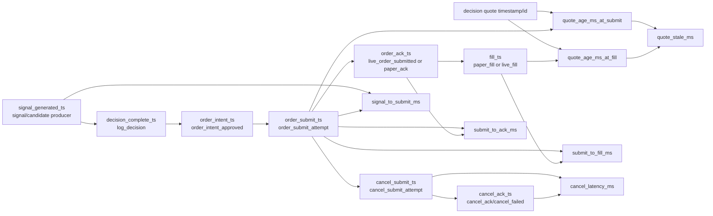
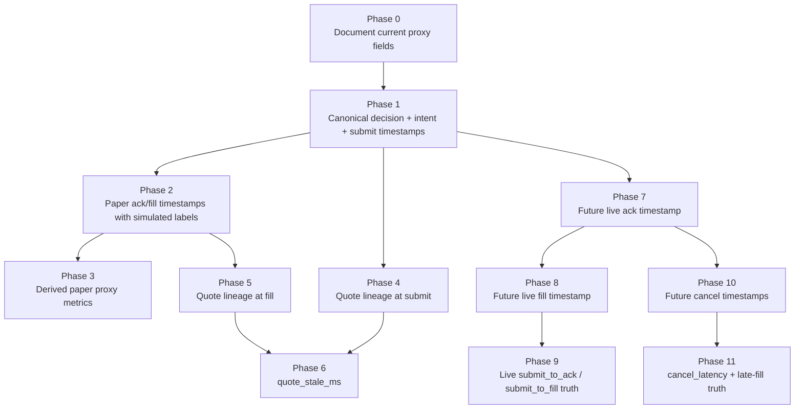

# Execution Timestamp Architecture Blueprint v1

Generated: 2026-05-22

Scope: design-only architecture for a future canonical execution timestamp layer.

Runtime behavior changed: No.
Live behavior changed: No.
Replay execution: No.
Paper launch: No.
S3 promotion: No.

## Non-Implementation Guardrail

This blueprint does not implement timestamp emission, replay logic, paper behavior, live behavior, strategy, risk, sizing, order placement, cancel handling, thresholds, or live config.

It defines field names, producer ownership, lineage, future metrics, and implementation phase order for a later explicitly scoped observability-only patch.

## Existing Proxy Timestamp Baseline

Current evidence already has useful proxies:

- JSONL envelope `timestamp_utc`
- decision payload `decision_timestamp`
- decision payload `decision_cycle_started_at`
- decision payload `market_evaluation_started_at`
- decision payload `market_evaluation_duration_ms`
- decision payload `decision_latency_ms`
- decision payload `last_orderbook_refresh_at`
- decision payload `orderbook_snapshot_age_ms_at_decision`
- decision payload `market_feed_age_ms`
- execution event envelope timestamps for `order_intent_approved`, `order_submit_attempt`, and `paper_fill`
- nested receipt `created_at`

These are not canonical execution truth. The future layer must preserve proxy fields while adding canonical fields with explicit producer ownership.

## Canonical Timestamp Field Graph

## Field Mapping Table

| Canonical Field | Producer | Event Type | JSONL Destination | Field Lineage | Future Metric |
|---|---|---|---|---|---|
| `signal_generated_ts` | signal/candidate construction boundary | decision candidate / future signal event | `decision_log` or future `signal_log` | first moment a side-specific signal candidate exists | `signal_to_submit_ms` |
| `decision_complete_ts` | decision emit boundary | `decision` | `decision_log` | final decision payload assembled, immediately before/at `log_decision` emit | `decision_to_intent_ms`, `signal_to_submit_ms` input |
| `order_intent_ts` | order intent approval boundary | `order_intent_approved` | `execution_log` | OrderIntent approved and risk/execution context prepared | `decision_to_intent_ms`, `intent_to_submit_ms` |
| `order_submit_ts` | submit attempt boundary | `order_submit_attempt` | `execution_log` | immediately before paper receipt creation or live client submit call | `signal_to_submit_ms`, `intent_to_submit_ms`, `submit_to_ack_ms`, `submit_to_fill_ms` |
| `order_ack_ts` | acknowledgement boundary | `paper_ack` / `live_order_submitted` | `execution_log` | paper ack is local/simulated; live ack is CLOB response receipt time | `submit_to_ack_ms` |
| `fill_ts` | fill boundary | `paper_fill` / future `live_fill` | `execution_log`, mirrored in `trade_journal` | paper fill local/simulated; live fill from order status/fill reconciliation | `submit_to_fill_ms` |
| `cancel_submit_ts` | cancel request boundary | `cancel_submit_attempt` | `execution_log` | immediately before cancel request is sent or simulated | `cancel_latency_ms` |
| `cancel_ack_ts` | cancel acknowledgement boundary | `cancel_ack` / `cancel_failed` | `execution_log` | cancel response, reject, timeout, or simulated result | `cancel_latency_ms` |

## Derived Metric Definitions

Metrics should be derived only when their required canonical fields exist and lineage matches.

| Metric | Definition | Required Fields | Valid In Paper? | Valid In Live? | Notes |
|---|---|---|---|---|---|
| `signal_to_submit_ms` | `order_submit_ts - signal_generated_ts` | `signal_generated_ts`, `order_submit_ts` | proxy/simulated | true if live submit timestamp is real | Must be side/candidate scoped. |
| `submit_to_ack_ms` | `order_ack_ts - order_submit_ts` | `order_submit_ts`, `order_ack_ts` | paper proxy | live truth | Paper ack must be labelled simulated. |
| `submit_to_fill_ms` | `fill_ts - order_submit_ts` | `order_submit_ts`, `fill_ts` | paper proxy | live truth only if fill source is exchange/reconciliation | Do not treat paper instant fill as executable fill truth. |
| `cancel_latency_ms` | `cancel_ack_ts - cancel_submit_ts` | `cancel_submit_ts`, `cancel_ack_ts` | paper proxy if simulated | live truth if response observed | Include cancel failed/timeout classification. |
| `quote_stale_ms` | max quote age at submit/fill | quote timestamp/id, `order_submit_ts`, `fill_ts` | proxy | true if quote lineage and timestamps are real | Prefer explicit `quote_age_ms_at_submit` and `quote_age_ms_at_fill`. |

## Insertion-Point Map

| Insertion Point | Future Field(s) | Existing Nearby Producer | Destination | Risk Level | Notes |
|---|---|---|---|---|---|
| decision emit | `decision_complete_ts` | decision payload builder before `log_decision` | `decision_log` | Low | Add alongside existing `decision_timestamp`; do not remove proxy fields. |
| signal/candidate creation | `signal_generated_ts` | candidate/signal id creation path | `decision_log` or future `signal_log` | Medium | Must avoid changing strategy or signal policy. Timestamp only. |
| order intent | `order_intent_ts` | `order_intent_approved` event emit | `execution_log` | Low | Existing event type already present. |
| submit | `order_submit_ts` | `order_submit_attempt` event emit | `execution_log` | Low | Capture immediately before paper/local or live submit call. |
| paper fill | `order_ack_ts`, `fill_ts`, `fill_source=paper_simulated` | paper receipt + `paper_fill` emit | `execution_log`, `trade_journal` | Low | Label as simulated/proxy. |
| future live ack | `order_ack_ts`, `ack_source=clob_response` | `client.place_limit_order` response | `execution_log` | Medium | Requires live-safe error handling; do not infer fill. |
| future live fill | `fill_ts`, `fill_source=clob_fill_or_reconcile` | order status / reconciliation | `execution_log`, `trade_journal` | Medium/High | Must distinguish ack from fill. |
| future cancel | `cancel_submit_ts`, `cancel_ack_ts` | cancel request/response boundary | `execution_log` | Medium | Include reject/timeout and late-fill-after-cancel flags. |

## Dependency Graph

## Implementation Phases

Design-only phase order for a future patch:

1. Phase 0 - Contract freeze:
   - Add docs/tests expectations only.
   - Confirm canonical field names and paper/live labels.

2. Phase 1 - Low-risk paper observability:
   - Add `decision_complete_ts`, `order_intent_ts`, and `order_submit_ts`.
   - No behavior changes.

3. Phase 2 - Paper simulated ack/fill:
   - Add paper `order_ack_ts` and `fill_ts`.
   - Add `ack_source=paper_simulated`, `fill_source=paper_simulated`.
   - Make clear these are proxy timings.

4. Phase 3 - Derived paper proxy metrics:
   - Compute `signal_to_submit_ms` only after `signal_generated_ts` exists.
   - Compute `submit_to_ack_ms` and `submit_to_fill_ms` as paper proxy metrics.
   - Prefix or label proxy status explicitly.

5. Phase 4 - Quote lineage:
   - Carry quote/snapshot id, token pair key, and `last_orderbook_refresh_at` into submit/fill.
   - Add `quote_age_ms_at_submit` and `quote_age_ms_at_fill`.

6. Phase 5 - Future live truth:
   - Add live `order_ack_ts` from CLOB response.
   - Add live `fill_ts` only from fill/reconciliation truth.
   - Do not infer fills from submit ack.

7. Phase 6 - Future cancel truth:
   - Add cancel submit/ack/fail timestamps.
   - Add late-fill-after-cancel and ghost-inventory observability.

## Paper vs Live Separation

Paper fields must be explicit:

- `execution_mode=paper`
- `ack_source=paper_simulated`
- `fill_source=paper_simulated`
- `latency_truth_class=SIMULATED_PROXY`

Live fields must be explicit:

- `execution_mode=live`
- `ack_source=clob_response`
- `fill_source=clob_fill_or_reconcile`
- `latency_truth_class=LIVE_OBSERVED`

Rules:

- Paper `fill_ts` never proves live fill latency.
- Live `order_ack_ts` never proves fill.
- Live fill truth requires order status, fill event, or reconciliation evidence.
- Cancel truth must separate submit, ack, reject, timeout, and late fill.

## Proxy vs Truth Separation

Keep proxy fields and truth fields separate.

Proxy examples:

- JSONL envelope `timestamp_utc`
- `decision_timestamp`
- `decision_latency_ms`
- receipt `created_at`
- paper `fill_ts`

Truth examples:

- live `order_ack_ts` from CLOB response
- live `fill_ts` from fill/reconciliation evidence
- live `cancel_ack_ts` from cancel response

Recommended classification field:

- `latency_truth_class`: `PROXY`, `SIMULATED_PROXY`, `LIVE_OBSERVED`, `UNKNOWN`

## Future Replay Compatibility

Replay should consume canonical fields in priority order:

1. Canonical truth fields with matching lineage.
2. Simulated paper fields with `latency_truth_class=SIMULATED_PROXY`.
3. Existing proxy fields only when explicitly running proxy-mode replay.

Replay requirements:

- require `candidate_trace_id` or `execution_trace_id` continuity
- require `paper_trade_replay_key` for paired open/close identity
- require quote lineage at submit/fill before computing `quote_stale_ms`
- treat missing canonical fields as `NOT_COMPUTABLE`, not zero
- store metric provenance beside derived metrics

## Lowest-Risk Path

Lowest-risk future implementation path:

1. Add canonical timestamp fields to existing payloads at already-emitted boundaries.
2. Add source/provenance labels without changing behavior.
3. Add regression tests proving payload shape only.
4. Add derived metrics after raw timestamps are stable.
5. Add quote lineage fields after timestamp fields exist.
6. Keep live ack/fill/cancel truth separate from paper simulation.

This preserves strategy, risk, execution, thresholds, and live config.

## S3 Implication

Status: CAUTION.

No promotion.

Reason:

- The architecture defines a path to latency truth, but no canonical fields have been implemented.
- Existing evidence remains proxy-only for latency and fill timing.
- Executable EV claims still require future timestamp, quote-lineage, fill, and cancel truth.

## Safety

- Runtime behavior changed: No.
- Live behavior changed: No.
- Runtime code modified: No.
- Strategy/risk/execution/live config modified: No.
- Replay run: No.
- Paper launch: No.
- Tests run: none; blueprint-only documentation.
- Persistent tests: unchanged; none deleted.

